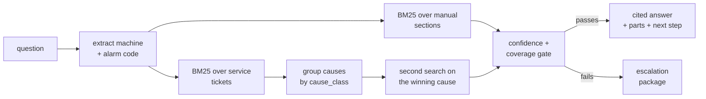
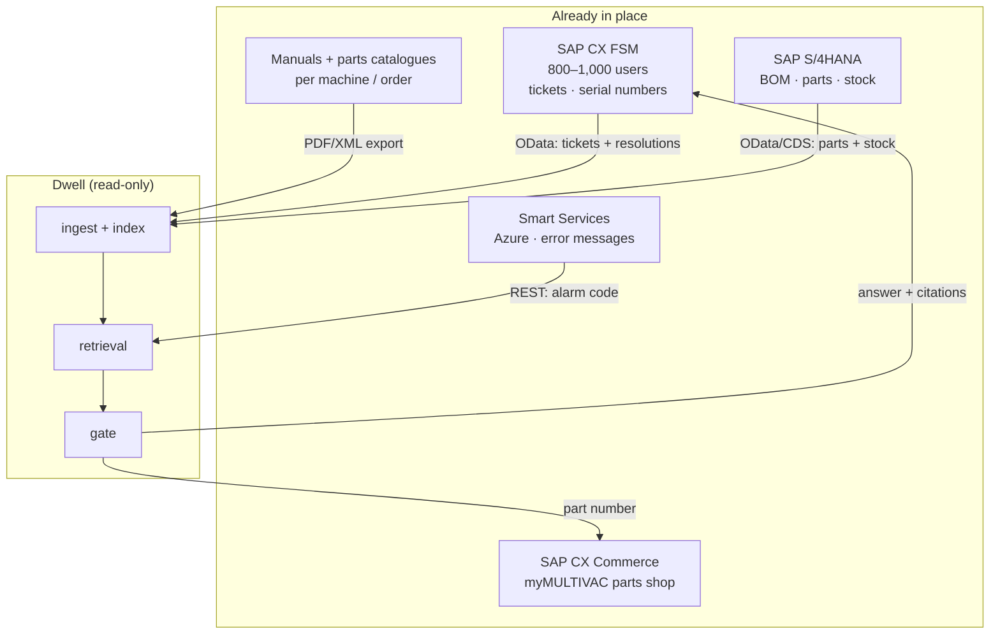

# Dwell

**Cited fault answers for packaging-machine service teams — and a clean refusal when the evidence isn't there.**

No dependencies · no API keys · no model download · same question, same answer, same citations, every time.

```bash
npm run ask "H 300 alarm 47 seals not holding vacuum on 200 micron film"
```

---

## The problem

A tray sealer stops holding vacuum at 02:40. The alarm code is real, the manual is 300 pages, and the person who has seen this fault forty times went to another site last quarter.

Three things go wrong at that moment:

1. **Knowledge is split across media that don't talk to each other** — alarm taxonomies in one document, procedures in another, fix history in a ticket system nobody full-text searches.
2. **A confident wrong answer is worse than no answer.** Recommending a pressure-regulator part when the actual cause is a torn PTFE cover costs a visit, a part, and the technician's trust in the tool.
3. **Documentation is moving onto screens, not into search.** Regulation (EU) 2023/1230 applies from 20 January 2027 and lets instructions for use be supplied digitally — which makes the manual machine-readable but not answerable. [^1]

Dwell's position: a service assistant earns adoption by **citing its sources and refusing when it shouldn't answer**, not by being chat-shaped.

## Is the problem real? — the evidence, separated from the assumptions

This is the part most prototypes skip. Below, every claim is either a **quote from a primary source** or explicitly marked as **not proven**. Nothing here is inferred from "the industry is digitising".

### What is documented

| # | Evidence | Source | What it establishes |
|---|---|---|---|
| 1 | A field service technician must *"troubleshoot or install **complex, customized** packaging and processing equipment... addressing high level challenges with **mechanical, electrical, pneumatic, and robotic** systems"*, *"working independently"*, and submit reports *"within 24 hours"* | [MULTIVAC Traveling Field Service Technician posting, Oct 2026](https://jobgether.com/offer/6adb377722c2644c03e2a6ae-traveling-field-service-technician--midwest) | The job is **autonomous diagnosis across four disciplines at an unfamiliar site, then documentation**. That is the exact shape of work retrieval helps — and the exact shape that breaks when the answer lives in one person's head |
| 2 | A **200-person** service organisation **"cut technician turnover in half"**; **31%** of field staff now come from a veteran-hiring pipeline; an apprenticeship programme was built to grow technicians internally; service generates **~45% of revenue** in that organisation | [VP of Customer Service, Future of Field Service, Jul 2025](https://www.futureoffieldservice.com/multivac-technician-turnover-reduction/) | People leave and take unrecorded knowledge with them. New hires are selected for **aptitude, not packaging-machine experience** — so ramp-up is a structural, recurring cost. And service is a **revenue line**, not a cost centre |
| 3 | *"The necessary maintenance stages, **which previously had to be looked up in instruction manuals**, can today be provided digitally and automatically."* | [MULTIVAC on Smart Services, Apr 2026](https://gulfoodmanufacturing.com/smart-services-the-motor-of-innovation-for-future-proof-production/) | The manufacturer itself names manual lookup as a cost it has paid — **for scheduled maintenance**. Unscheduled fault diagnosis is the part still unsolved |
| 4 | Service ran on *"an in-house solution in the service area"*, replaced by **SAP CX FSM (800–1,000 users)**; stated goals were *"a better connection to mobile devices, more efficient resource planning, optimization of technician deployments and overall leaner and simpler processes"* | [Sybit SAP CX case study](https://www.sybit.com/en/customers/success-stories/multivacs-experience-with-sap) | The service workflow is modern and mobile — **diagnosis is absent from the requirements list**. The gap is documented by omission, by the partner who did the work |
| 5 | Parts shop already shows *"price and availability"*, *"automatically records the serial numbers"*, with emergency ordering; the portal is a *"new entry point for smart services... live machine data such as... **error messages**"* | [Sybit SAP CX case study](https://www.sybit.com/en/customers/success-stories/multivacs-experience-with-sap) | The **signal** (error messages) and the **transaction** (parts) already exist. Only the interpretation between them is missing |
| 6 | Smart Services IIoT platform: *"Micro-Frontend-Architektur auf Basis von **Microsoft Azure** und Web-Technologien wie **Vue3 und Nest Js**"*, plus edge computing | [CIO.de, Concept Reply project](https://www.cio.de/article/3694903/multivac-entwickelt-iot-dienste-fuer-die-industrie.html) | Their digital team already ships web services on mainstream stacks. A Node retrieval service is not a foreign object |

### What is *not* proven — and what it would take

| Unknown | Why it decides everything | How to settle it |
|---|---|---|
| **First-time-fix rate** and visits per incident | If it is already ~90%, the upside is small and this pitch is wrong | One question to the service director |
| **Time from arrival to diagnosis** | This is the quantity the product reduces; nobody publishes it | Same call |
| Whether ticket **resolutions are written down**, and in which language | "2 of 4 were the seal bar" is impossible without a normalised cause field | Look at 20 closed tickets |
| Whether technicians **search** or just phone a colleague | If the phone works in two minutes, the tool must beat the phone, not the PDF | Shadow one technician for a day |
| Works council / AI policy on assistance tools | Can stop a German rollout regardless of technical merit | Ask in week one, not week four |

**Explicitly not claimed:** headcount and hourly-cost figures. The saving arithmetic that appears in early notes (`1,500 technicians × 30 min × €60/h`) uses **invented inputs** and should not be quoted as a forecast.

## What you get back

Every response is one of two things. Real output, produced by the command above:

```text
Q: H 300 alarm 47 seals not holding vacuum on 200 micron film
   H 300 · alarm 47 · confidence 0.756 · coverage 0.778

ANSWER
  Alarm 47: vacuum not reached during sealing cycle.        [40-49 Sealing station alarms]
  The most common cause of a non-sealing machine is contamination or wear on
  the seal bar PTFE cover, not a failure of the pressure regulator. [7.1 Sealing station overview]

LIKELY CAUSES (from service history)
  2 of 4: Seal bar PTFE cover torn, seam not gas tight   T-10412, T-10488
          fix used: Replaced seal bar and PTFE cover, ran three empty cycles, leak test passed
  1 of 4: Vacuum sensor B21 drift                        T-11041
  1 of 4: Vacuum pump vane set worn beyond limit         T-10607

PARTS
  105420118  Seal bar 320 mm              · stock 4  · €418.00 · seen in similar tickets
  105420126  PTFE cover set, seal bar     · stock 12 · €74.50  · seen in similar tickets

NEXT STEP
  Inspect the PTFE cover of the seal bar at every shift change.

SOURCES
  [1] 40-49 Sealing station alarms — alarm and error code taxonomy  (§error-codes)
  [2] 7.1 Sealing station overview — H 300 operating manual         (§h300-sealing)
```

…or an escalation package, with the same honesty:

```text
Q: what is the torque for the C 400 chamber lid hinge
   machine not specified · confidence 0.254 · coverage 0.2

ESCALATE — not enough grounded evidence to answer safely

Closest material found (below threshold, do not rely on it):
  - 5.3 Chamber seal and door gasket [h300-vacuum] score 4.26

Attach to the ticket:
  - machine number and variant from the nameplate
  - alarm log export for the last 24 h
```

`C 400` is not in the corpus. The system refuses rather than borrowing H 300 content — that behaviour is the product.

## How it works



Four mechanics carry the quality, more than the model choice:

| Mechanic | Why it matters | Source |
|---|---|---|
| **Machine-aware boosting** | Named machine ×1.9, cross-machine taxonomy ×1.05, mismatched machine ×0.55 — penalised, not filtered, so generic taxonomies still surface | [`bm25.js:187-189`](src/bm25.js) |
| **Alarm-literal boost** | An explicit code matches the section documenting it, ×1.6 | [`bm25.js:194`](src/bm25.js) |
| **Lexical bridge** | Bidirectional synonym groups at weight 0.6 let `Fehler 47 Siegelnaht undicht` reach an English manual; `µm` ↔ `micron` | [`bm25.js:10-103`](src/bm25.js) |
| **Two-pass retrieval** | A second search runs against the *cause text*, because "not holding vacuum" and "replace seal bar" share no vocabulary | [`answer.js:321-335`](src/answer.js) |

## The gate

```
confidence = 0.55 · (1 − e^(−topScore / 12)) + 0.45 · coverage
```

Answer requires `confidence ≥ 0.55` **and** `coverage ≥ 0.40`; confidence is halved when the question names an alarm no retrieved section documents. [`answer.js:4-5,178`](src/answer.js) Two calibration constants, deliberately blunt, and the only two numbers in the project that are a judgement call rather than a measurement.

## Measured results

Rerun everything in this README yourself — it takes about a second:

```bash
npm run eval          # 15 golden questions, exits 1 on failure
echo $?               # 0 for an answered run, 2 when the last query escalated
```

| Claim | Measured | Where |
|---|---|---|
| Expected document appears in top sources | **100%** (11/11) | [`eval/run.js`](eval/run.js) |
| Out-of-scope questions refused | **100%** (4/4) | [`eval/golden.json`](eval/golden.json) |
| Citation precision | **100%** | [`eval/run.js`](eval/run.js) |
| Zero runtime dependencies | 0 | [`package.json`](package.json) |
| Deterministic | no network, no env vars, no randomness in `src/` | [`src/`](src) |
| Corpus scale | 5 documents → 26 sections, 15 tickets, 12 parts, 41 indexed chunks | [`src/corpus.js:30-90`](src/corpus.js) |

## Fits the existing stack

The point of this section: **no replacement, no migration, no ABAP.** The service reads what they already have, and writes nothing back except an optional note on a ticket.



| Their system | Interface | Direction | Used for |
|---|---|---|---|
| SAP CX FSM | OData / REST | **Read** | Symptom text, resolution, cause, machine serial |
| SAP CX FSM | API note | **Write (optional)** | Post answer + citations onto the ticket as an audit trail |
| SAP S/4HANA | OData V2/V4, CDS views | **Read** | Which part belongs to this machine; supersession; stock |
| SAP CX Commerce | OCC REST | **Read**, then hand off | Turn "this is the part" into an order in the existing shop |
| Smart Services (Azure) | REST / Event Hub | **Read** | Pre-fill the alarm; correlate with history |
| Documentation store | File / PDF export | **Read once, ingest** | Answer text and citations |
| Machine / PLC | — | **Never** | No control writes, no setpoints, no safety parameters |

### Three ways to attach it

| Option | What it is | Change to SAP | Effort |
|---|---|---|---|
| **A — Standalone behind SSO** *(pilot default)* | Separate URL, OIDC against SAP Cloud Identity or Entra ID | **None** | 2–3 days |
| **B — Embedded in FSM** | "Diagnose" tab inside the ticket screen and mobile app, context passed in | Configuration only | 4–10 days |
| **C — Native on SAP BTP / Joule** | Retrieval exposed as a Joule action via Joule Studio | Entitlement + security review | 3–6 weeks |

Start with A, design for C. SAP is shipping Joule assistants for FSM through 2026 — the durable position is being the **grounded corpus and evidence layer**, deployable inside Joule or beside it.

### Portable vs project

| | Days | Why |
|---|---|---|
| The retrieval core, gate and renderer | **~1** | Stateless Node process, no database, no GPU, no API keys; wrap in ~40 lines of HTTP |
| SSO + container + corpus load | 2–3 | Standard |
| PDF/manual ingestion | 5–10 | Scanned PDFs, per-machine variants, revision history |
| Ticket cause normalisation | 5–10 | Without a `cause_class`, "2 of 4" collapses to "1 of 1" |
| Machine-variant scoping by serial | 3–5 | Same alarm means different things on different variants |
| German in, German out | 3–5 | Expansion bridges query → English; output needs a translation layer |
| Parts supersession | 5–10 | Legacy → current numbers, per machine. Decides the parts ROI |

Two weeks of engineering gets a working tool on their documents. Four to six weeks gets the *data* right. Nothing in that list is a research problem.

## Future scope

| Phase | Scope | Gate to pass |
|---|---|---|
| **0 — now** | Retrieval + gate on a synthetic corpus, CLI, 15-question eval | Reproducible answers, honest refusals |
| **1 — pilot (4 weeks)** | One machine family, one subsidiary, real manuals + 12 months of tickets; 40–60 golden questions written by senior technicians; standalone app behind SSO; shadow mode | Answer acceptance ≥ 60%, corpus cleanable in 10 days |
| **2 — product** | FSM embedding; multilingual answers (DE/ES/PT); variant scoping by serial; telemetry correlation from Smart Services; parts supersession; technician-correction feedback loop | Adoption per subsidiary, parts capture delta |
| **3 — platform** | Joule action on BTP; reranker trained on accepted/corrected answers; air-gapped deployment for customers who forbid cloud | Reference customer, measured FTF delta |

Explicitly **out of scope at every phase**: machine control, safety functions, autonomous ordering without human confirmation, and any answer without a citation.

## Limits — read before you judge the numbers

- **The corpus is synthetic.** The manuals, tickets, part numbers, and machine model designations in `data/` were written for this prototype. They are not extracted from, derived from, or affiliated with any manufacturer's documentation. Method and code are real; the documents are not.
- **15 questions is a smoke test, not a benchmark.** 100% on a hand-authored set you also tuned against means the *mechanism* works, not that accuracy is 100%. A real evaluation needs 40–60 questions written by working technicians.
- **Ticket evidence isn't in the hit-rate metric.** Tickets are indexed as `ticket:T-…` document ids while the golden set expects manual ids, so the 11/11 measures manual retrieval only.
- **Citation precision is reported, not gated** — only hit rate (≥0.8) and abstention (=1.0) can fail the run.
- **German questions in, German answers out.** Query expansion bridges into English; output is not translated.
- **Vocabulary-bound by design.** A symptom phrased with words absent from the corpus is refused rather than guessed.
- **No UI, no server, no persistence.** This is a CLI prototype, because the retrieval-and-gate question had to be answered before any interface existed.

## Layout

```text
src/corpus.js   loading, `##`-heading chunking, machine + alarm detection
src/bm25.js     BM25, stemming, synonym expansion, boost rules
src/answer.js   sentence ranking, cause aggregation, confidence gate, rendering
src/cli.js      entry point
data/           synthetic corpus: manuals, tickets, parts
eval/           golden question set + harness
```

## Status

Prototype, single workflow, read-only. Nothing here writes to a machine, so nothing here touches a safety function.

## License

No `LICENSE` file yet — the code is public to read and run, all rights otherwise reserved. Ping me before building on it.

[^1]: Regulation (EU) 2023/1230 of the European Parliament and of the Council of 14 June 2023 on machinery and repealing Directive 2006/42/EC, [EUR-Lex](https://eur-lex.europa.eu/eli/reg/2023/1230/oj/eng). Applies from 20 January 2027.
